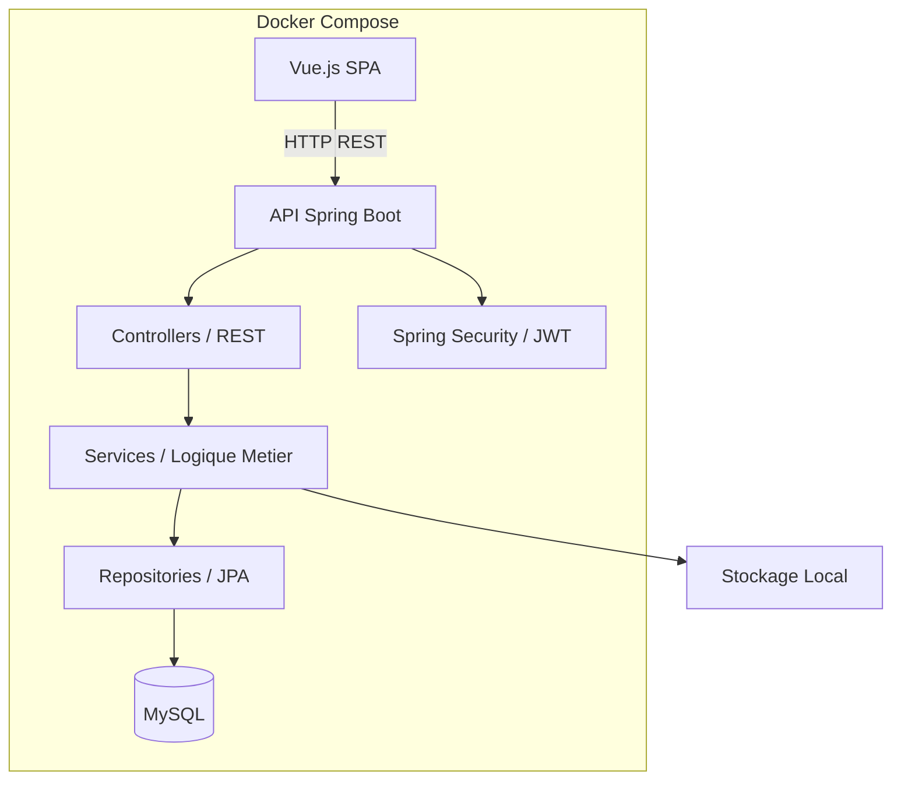
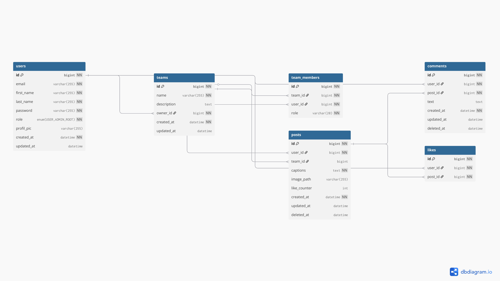

<div align="center">

<a href="https://github.com/sofian-bll/ept-connectin-java/blob/main/LICENSE">
  
</a>
<a href="https://github.com/sofian-bll/ept-connectin-java/releases">
  
</a>
<a href="https://github.com/sofian-bll/ept-connectin-java/stargazers">
  
</a>

<br>

<p align="center">
  
</p>

<h1 id="readme-top">Connect'In v2 — API Spring Boot</h1>

<p>
  <strong>Projet Epitech — Migration complete du backend Laravel vers Spring Boot.</strong><br>
  <em>Meme frontend, nouvelle puissance sous le capot.</em>
</p>

<p align="center">🇬🇧 <a href="README.md">English</a> · 🇫🇷 <a href="README.fr.md"><b>Français</b></a></p>

<br>

<p align="center">
  <a href="https://sofian-bll.github.io/ept-connectin-java/"><strong>Explorer la doc</strong></a>
  ·
  <a href="https://sofian-bll.github.io/ept-connectin-java/"><strong>Voir la Demo</strong></a>
  ·
  <a href="https://github.com/sofian-bll/ept-connectin-java/issues/new"><strong>Signaler un bug</strong></a>
  ·
  <a href="https://github.com/sofian-bll/ept-connectin-java/issues/new"><strong>Demander une fonctionnalite</strong></a>
</p>

</div>

---

## C'est quoi ?

Connect'In est un réseau social professionnel réalisé dans le cadre d'Epitech. Le backend Laravel d'origine a été intégralement migré vers une **API Java Spring Boot en monolithe modulaire**, couvrant l'authentification (JWT), les utilisateurs, les posts, les commentaires, les likes et les équipes — le tout en conservant le frontend Vue.js existant **strictement inchangé**.

L'objectif : reproduire fidèlement chaque route et payload tout en améliorant la robustesse, la sécurité et la structure du code avec Java Spring Boot.

---

## Stack Technique

- [![Java][java-shield]](https://www.oracle.com/java/) — Runtime
- [![Spring Boot][spring-shield]](https://spring.io/projects/spring-boot) — Framework backend
- [![Maven][maven-shield]](https://maven.apache.org/) — Outil de build
- [![MySQL][mysql-shield]](https://www.mysql.com/) — Base de donnees
- [![Docker][docker-shield]](https://www.docker.com/) — Conteneurisation
- [![Vue.js][vue-shield]](https://vuejs.org/) — Client frontend (fourni)

---

## Sommaire

<details open>
<summary>Sommaire</summary>

- [C'est quoi ?](#cest-quoi-)
- [Stack Technique](#stack-technique)
- [Fonctionnalites & Architecture](#fonctionnalites--architecture)
- [Demarrage](#demarrage)
- [Comptes de test](#comptes-de-test)
- [Documentation API](#documentation-api)
- [Routes API](#routes-api)
- [Schema de base de donnees](#schema-de-base-de-donnees)
- [Demo](#demo)
- [Structure du projet](#structure-du-projet)
- [Contribuer](#contribuer)
- [Licence](#licence)
- [Star History](#star-history)

</details>

---

## Fonctionnalites & Architecture

### Fonctionnalites

- **Authentification** — Register/Login sécurisé par JWT et Spring Security.
- **Utilisateurs** — Gestion du profil, upload d'avatar, recherche, suppression/anonymisation.
- **Social** — CRUD des posts (avec images et gestion d'équipe), commentaires et likes.
- **Équipes** — Création, gestion des membres et des rôles.
- **Data** — Seeders de données idempotents pour une démo immédiate.

### Bonus

- Cache applicatif avec Spring (`@Cacheable` / `@CacheEvict`).
- Tests unitaires couverts par JUnit + Mockito.
- Gestion d'erreurs JSON centralisée via `@ControllerAdvice`.
- Conteneurisation complète (Dev & Prod) pilotée par Makefile.

### Architecture

L'application suit un monolithe modulaire orienté domaine — chaque domaine métier (auth, user, post, comment, like, team) est isolé avec ses propres Controller, Service, Repository et DTO.

```text
backend/src/main/java/com/connect_in/backend/
 ├── auth/
 ├── user/
 ├── post/
 ├── comment/
 ├── like/
 ├── team/
 └── shared/
```

### Diagramme d'Architecture



<p align="right">(<a href="#readme-top">haut de page</a>)</p>

---

## Demarrage

### Prerequisites

- **Docker Desktop** (pour la BDD et le deploiement)
- **Node.js** (pour lancer le frontend fourni)

### Quick Start

```bash
git clone git@github.com:sofian-bll/ept-connectin-java.git
cd connect-in-java
```

### Commandes

Un `Makefile` est fourni pour simplifier l'expérience développeur.

| Commande | Description |
|----------|------------|
| `make dev` | Lance l'environnement de développement (hot-reload) |
| `make prod` | Lance l'environnement de production |
| `make down` / `make down-dev` | Stoppe les conteneurs (Prod / Dev) |
| `make reset` / `make reset-dev` | Réinitialise la base de données (Prod / Dev) |
| `make clean` | Purge les images et volumes Docker |
| `make logs` / `make logs-db` | Logs en direct (Backend / BDD) |

**Sans Makefile (Docker Compose directement) :**

```bash
# Développement
docker compose -f docker-compose.dev.yml up --build --force-recreate

# Production
docker compose up --build --force-recreate
```

<p align="right">(<a href="#readme-top">haut de page</a>)</p>

---

## Comptes de test

Utilisez ces comptes générés par les seeders pour tester immédiatement :

| Email | Password |
|---|---|
| `sofian@test.com` | `password123` |
| `alice@test.com` | `password123` |
| `bob@test.com` | `password123` |
| `shanisya@test.com` | `password123` |

<p align="right">(<a href="#readme-top">haut de page</a>)</p>

---

## Documentation API

Swagger UI est disponible en local une fois l'application lancee.

| Ressource | Lien |
|-----------|------|
| Swagger UI | [http://localhost:8080/swagger-ui/index.html](http://localhost:8080/swagger-ui/index.html) |
| OpenAPI JSON | [http://localhost:8080/v3/api-docs](http://localhost:8080/v3/api-docs) |

**Documentation exportée :**

| Document | PDF | Markdown |
|----------|-----|----------|
| Documentation API | [API.pdf](Resources/docs/ApiDocumentation.pdf) | [API.md](Resources/notes/ApiDocumentation.md) |
| Connect'In v2 | [V2.pdf](Resources/docs/ConnectInVersion2.pdf) | [V2.md](Resources/notes/ConnectInVersion2.md) |
| Sujet du projet | [Sujet.pdf](Resources/docs/project.pdf) | [Sujet.md](Resources/notes/project.md) |

<p align="right">(<a href="#readme-top">haut de page</a>)</p>

---

## Routes API

<details>
<summary><b>Auth & Utilisateurs</b></summary>

| Methode | Endpoint | Description |
|---------|----------|-------------|
| `POST` | `/api/register` | Creer un compte |
| `POST` | `/api/login` | Obtenir un token JWT |
| `GET` | `/api/user` | Profil de l'utilisateur connecte |
| `PUT` | `/api/user/update` | Modifier le profil |
| `POST` | `/api/user/avatar` | Uploader un avatar |
| `DELETE` | `/api/user` | Supprimer le compte |
| `GET` | `/api/users/search?q=` | Rechercher des utilisateurs |

</details>

<details>
<summary><b>Posts & Commentaires</b></summary>

| Methode | Endpoint | Description |
|---------|----------|-------------|
| `GET` | `/api/posts` | Lister les posts (filtre `?team_id=`) |
| `GET` | `/api/posts/{id}` | Details d'un post |
| `POST` | `/api/posts` | Creer un post (`multipart`) |
| `PUT` | `/api/posts/{id}` | Modifier un post |
| `DELETE` | `/api/posts/{id}` | Supprimer un post |
| `GET` | `/api/posts/{postId}/comments` | Commentaires d'un post |
| `POST` | `/api/posts/{postId}/comments` | Ajouter un commentaire |
| `PUT` | `/api/comments/{id}` | Modifier un commentaire |
| `DELETE` | `/api/comments/{id}` | Supprimer un commentaire |

</details>

<details>
<summary><b>Likes & Equipes</b></summary>

| Methode | Endpoint | Description |
|---------|----------|-------------|
| `POST` | `/api/posts/{id}/like` | Toggle like |
| `GET` | `/api/teams` | Lister les équipes |
| `POST` | `/api/teams` | Creer une equipe |
| `GET` | `/api/teams/{id}` | Details d'une equipe |
| `DELETE` | `/api/teams/{id}` | Supprimer une equipe |
| `POST` | `/api/teams/{id}/members` | Ajouter un membre |
| `DELETE` | `/api/teams/{id}/members/{memberId}` | Retirer un membre |

</details>

<p align="right">(<a href="#readme-top">haut de page</a>)</p>

---

## Schema de base de donnees

<p align="center">
  
  <br><em>Vue alternative disponible [ici](Resources/images/db/db-diagram-2.jpg).</em>
</p>

<p align="right">(<a href="#readme-top">haut de page</a>)</p>

---

## Demo

Le projet est deploye a l'adresse :

<p align="center">
  <a href="https://sofian-bll.github.io/ept-connectin-java/"><strong>sofian-bll.github.io/ept-connectin-java/</strong></a>
</p>

La landing page presente les fonctionnalites, la stack technique et l'architecture du projet. Pour tester l'API, lancez le projet en local et ouvrez Swagger UI : [http://localhost:8080/swagger-ui/index.html](http://localhost:8080/swagger-ui/index.html).

<p align="right">(<a href="#readme-top">haut de page</a>)</p>

---

## Structure du projet

```text
├── backend/        # Code source de l'API Spring Boot
├── frontend/       # Code source du client (ne pas modifier)
├── Resources/      # Documentation, schemas BDD, captures, collections Bruno
├── storage/        # Fichiers uploades (avatars, images de posts)
├── assets/         # Logo et assets
├── docker-compose.yml
├── docker-compose.dev.yml
└── Makefile
```

<p align="right">(<a href="#readme-top">haut de page</a>)</p>

---

## Contribuer

Les contributions sont les bienvenues. Fork → branche → PR — le workflow open-source standard.

<p align="center">
  <a href="https://github.com/sofian-bll/ept-connectin-java/graphs/contributors">
    
  </a>
</p>

<p align="right">(<a href="#readme-top">haut de page</a>)</p>

---

## Licence

Distribue sous licence MIT. Voir [LICENSE](LICENSE) pour plus d'informations.

<p align="right">(<a href="#readme-top">haut de page</a>)</p>

---

## Star History

<picture>
  <source media="(prefers-color-scheme: dark)" srcset="https://api.star-history.com/svg?repos=sofian-bll/ept-connectin-java&type=Date&theme=dark">
  <source media="(prefers-color-scheme: light)" srcset="https://api.star-history.com/svg?repos=sofian-bll/ept-connectin-java&type=Date&theme=default">
  
</picture>

---

<!-- REFERENCE_LINKS -->
[java-shield]: https://img.shields.io/badge/java%2025-%23ED8B00.svg?style=flat&logo=openjdk&logoColor=white
[spring-shield]: https://img.shields.io/badge/Spring%20Boot%204-6DB33F.svg?style=flat&logo=Spring-Boot&logoColor=white
[maven-shield]: https://img.shields.io/badge/Apache%20Maven-C71A36?style=flat&logo=Apache%20Maven&logoColor=white
[mysql-shield]: https://img.shields.io/badge/mysql%208.4-%2300f.svg?style=flat&logo=mysql&logoColor=white
[docker-shield]: https://img.shields.io/badge/docker-%230db7ed.svg?style=flat&logo=docker&logoColor=white
[vue-shield]: https://img.shields.io/badge/vuejs-%2335495e.svg?style=flat&logo=vuedotjs&logoColor=%234FC08D
[license-shield]: https://img.shields.io/github/license/sofian-bll/ept-connectin-java?style=flat
[version-shield]: https://img.shields.io/github/v/release/sofian-bll/ept-connectin-java?style=flat
[stars-shield]: https://img.shields.io/github/stars/sofian-bll/ept-connectin-java?style=flat
