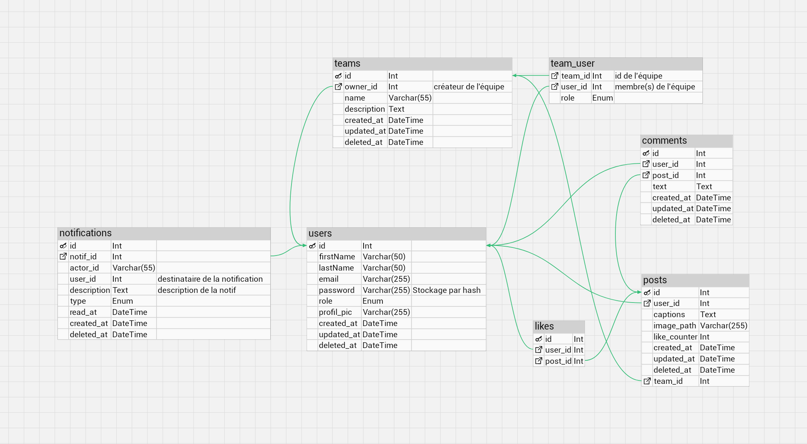
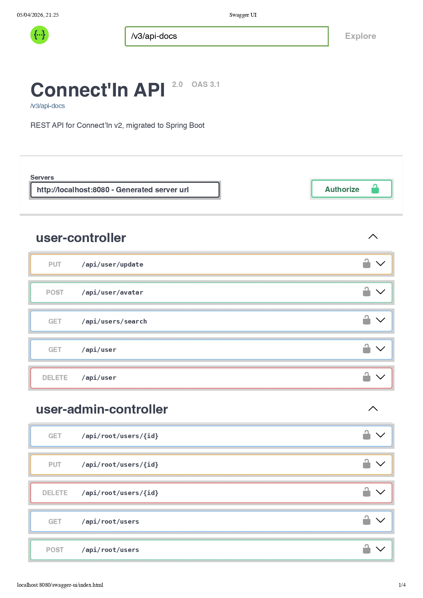
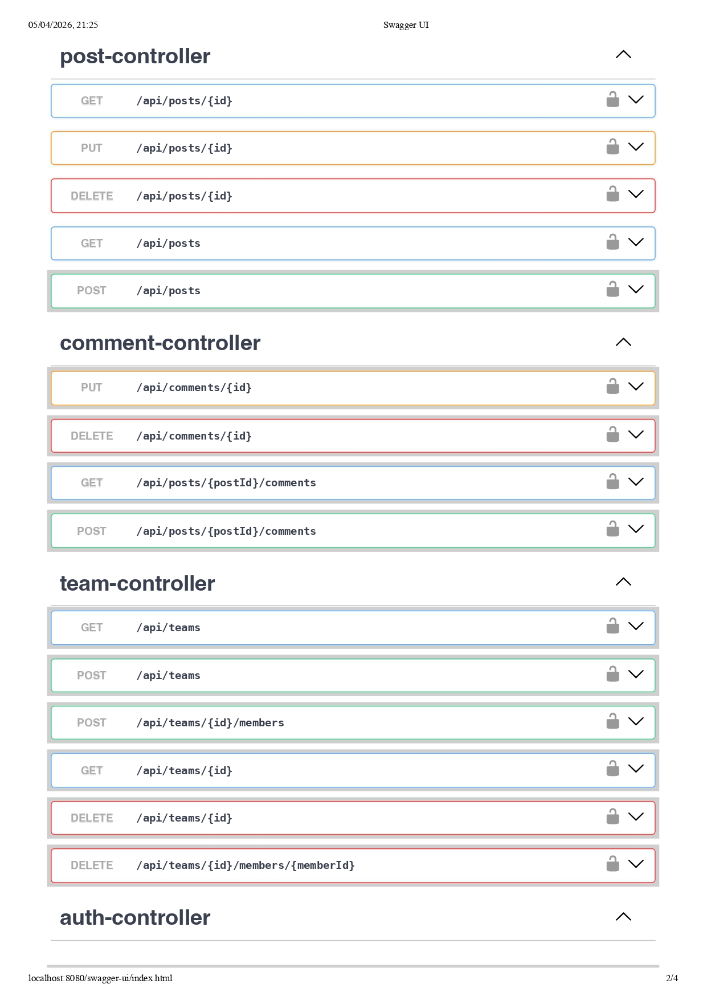
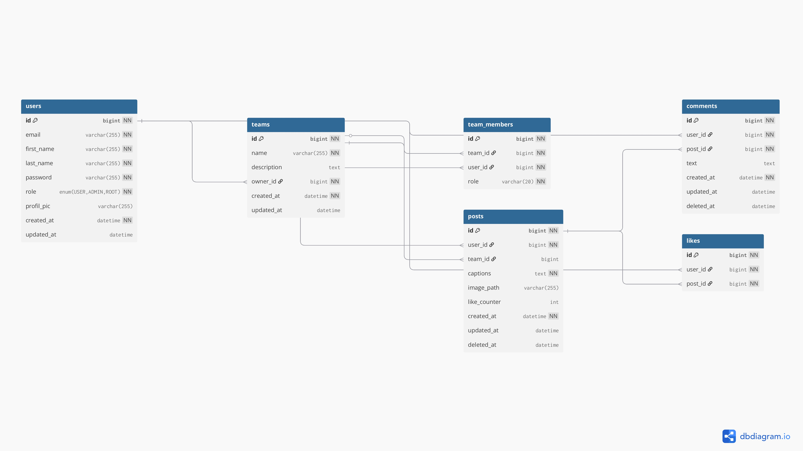
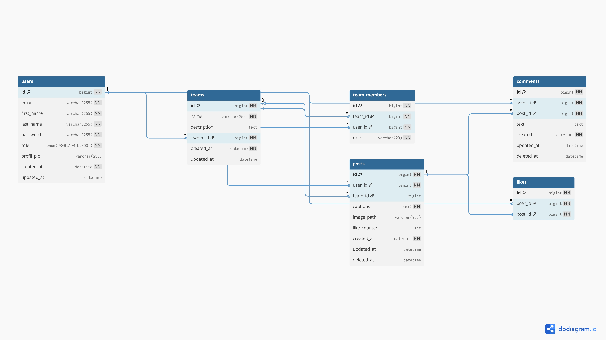

<!-- Improved compatibility of back to top link: See: https://github.com/othneildrew/Best-README-Template/pull/73 -->
<a id="readme-top"></a>

<!-- PROJECT LOGO -->
<br />
<div align="center">
  <a href="#readme-top">
    
  </a>

  <h3 align="center">Connect'In v2 — Spring Boot API</h3>

  <p align="center">
    Migration du backend Laravel vers Spring Boot, frontend inchangé.
    <br />
    <a href="#getting-started"><strong>Getting Started</strong></a>
    ·
    <a href="#api-documentation">API Docs</a>
    ·
    <a href="#database-diagram">DB Diagram</a>
  </p>
</div>

<!-- TABLE OF CONTENTS -->
<details>
  <summary>Table of Contents</summary>
  <ol>
    <li>
      <a href="#about-the-project">About The Project</a>
      <ul>
        <li><a href="#built-with">Built With</a></li>
      </ul>
    </li>
    <li>
      <a href="#features">Features</a>
      <ul>
        <li><a href="#bonus">Bonus</a></li>
        <li><a href="#architecture">Architecture</a></li>
      </ul>
    </li>
    <li>
      <a href="#getting-started">Getting Started</a>
      <ul>
        <li><a href="#prerequisites">Prerequisites</a></li>
        <li><a href="#installation">Installation</a></li>
        <li><a href="#makefile-commands">Makefile Commands</a></li>
        <li><a href="#without-makefile">Without Makefile</a></li>
      </ul>
    </li>
    <li><a href="#seed-accounts">Seed Accounts</a></li>
    <li><a href="#api-documentation">API Documentation</a></li>
    <li><a href="#database-diagram">Database Diagram</a></li>
    <li><a href="#routes-summary">Routes Summary</a></li>
    <li><a href="#project-structure">Project Structure</a></li>
    <li><a href="#constraints">Constraints</a></li>
  </ol>
</details>

<!-- ABOUT THE PROJECT -->
## About The Project

Connect'In v2 est une migration complète du backend Laravel vers Java Spring Boot, avec une contrainte forte: **le frontend ne doit pas être modifié**. L'objectif est de reproduire fidèlement les routes et payloads attendus par le client existant, tout en améliorant la robustesse (erreurs, sécurité, docker) et la structure du code.

<p align="right">(<a href="#readme-top">back to top</a>)</p>

### Built With

* Java 25
* Spring Boot 4
* Spring Security + JWT
* Spring Data JPA + Hibernate
* MySQL 8.4
* Docker + Docker Compose
* Maven

<p align="right">(<a href="#readme-top">back to top</a>)</p>

<!-- FEATURES -->
## Features

- Auth JWT (register/login) + profil utilisateur
- Users: profile update, avatar upload, search, delete (anonymize/delete)
- Posts CRUD + images + team posts
- Comments CRUD
- Likes toggle
- Teams + members + roles
- Seed data pour démo rapide

### Bonus

- Cache Spring (`@Cacheable` / `@CacheEvict`)
- Seeders idempotents (démo immédiate)
- Tests unitaires JUnit + Mockito
- Docker dev/prod propre + Makefile
- Gestion d'erreurs JSON uniformisée

### Architecture

Modular Monolith (par domaine métier) :

```
backend/src/main/java/com/connect_in/backend/
  auth/
  user/
  post/
  comment/
  like/
  team/
  shared/
```

Cette structure isole chaque domaine (controller/service/repository/dto) dans un module cohérent tout en conservant un déploiement unique.

<p align="right">(<a href="#readme-top">back to top</a>)</p>

<!-- GETTING STARTED -->
## Getting Started

### Prerequisites

- Docker Desktop
- Node.js (pour le frontend)

### Installation

```bash
git clone <PRIVATE_REPO_URL>
cd connect-in-java
```

### Makefile Commands

```bash
make dev        # compose dev (hot-reload)
make prod       # compose prod
make down       # stop prod
make down-dev   # stop dev
make reset      # reset db prod
make reset-dev  # reset db dev
make clean      # purge images + volumes
make logs       # backend logs
make logs-db    # db logs
```

### Without Makefile

```bash
# Dev
docker compose -f docker-compose.dev.yml up --build --force-recreate

# Prod
docker compose up --build --force-recreate
```

<p align="right">(<a href="#readme-top">back to top</a>)</p>

<!-- SEED ACCOUNTS -->
## Seed Accounts

```
sofian@test.com   / password123
alice@test.com    / password123
bob@test.com      / password123
shanisya@test.com / password123
```

<p align="right">(<a href="#readme-top">back to top</a>)</p>

<!-- API DOCUMENTATION -->
## API Documentation

Swagger UI (local):

- http://localhost:8080/swagger-ui/index.html
- http://localhost:8080/v3/api-docs

Images exportées:




<p align="right">(<a href="#readme-top">back to top</a>)</p>

<!-- DATABASE DIAGRAM -->
## Database Diagram




<p align="right">(<a href="#readme-top">back to top</a>)</p>

<!-- ROUTES SUMMARY -->
## Routes Summary

Auth:
- `POST /api/register`
- `POST /api/login`

Users:
- `GET /api/user`
- `PUT /api/user/update`
- `POST /api/user/avatar`
- `DELETE /api/user`
- `GET /api/users/search?q=`

Posts:
- `GET /api/posts`
- `GET /api/posts?team_id=`
- `GET /api/posts/{id}`
- `POST /api/posts` (multipart)
- `PUT /api/posts/{id}`
- `DELETE /api/posts/{id}`

Comments:
- `GET /api/posts/{postId}/comments`
- `POST /api/posts/{postId}/comments`
- `PUT /api/comments/{id}`
- `DELETE /api/comments/{id}`

Likes:
- `POST /api/posts/{id}/like`

Teams:
- `GET /api/teams`
- `POST /api/teams`
- `GET /api/teams/{id}`
- `DELETE /api/teams/{id}`
- `POST /api/teams/{id}/members`
- `DELETE /api/teams/{id}/members/{memberId}`

<p align="right">(<a href="#readme-top">back to top</a>)</p>

<!-- PROJECT STRUCTURE -->
## Project Structure

```
backend/        -> Spring Boot API
frontend/       -> Frontend (déjà fourni)
Resources/      -> Docs, images, Bruno collections
```

<p align="right">(<a href="#readme-top">back to top</a>)</p>

<!-- CONSTRAINTS -->
## Constraints

- Frontend **strictement inchangé**
- Contrat d'API respecté (routes + JSON)
- Déploiement Docker (dev + prod)

<p align="right">(<a href="#readme-top">back to top</a>)</p>
